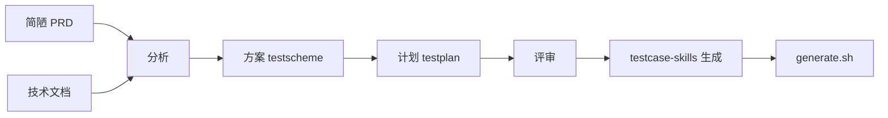

# testplan-skills — 测试方案与测试计划

从 **简陋 PRD + 开发技术文档** 生成 **测试方案**（`*_testscheme.md`）和 **测试计划**（`*_testplan.md`）。不写具体用例步骤。

---

## 流水线

```
00_知识增强约定（可选 RAG）
        ↓
   分析 → 方案 → 计划 → 评审
        ↓
testcase-skills/生成（用例，方案评审通过后）
        ↓
api-skills + ./generate.sh（自动化，可选）
```



---

## 快速开始

```text
@testplan-skills/分析/SKILL.md
@examples/prd_mini_seckill_auth.md
@examples/tech_mini_seckill.md

输出 analysis YAML，再进入方案/计划。
```

```text
@testplan-skills/方案/SKILL.md
@examples/prd_mini_seckill_auth.md
@examples/tech_mini_seckill.md

按 scheme_template 生成，输出 output/seckill_testscheme.md
对照黄金样例：examples/test-plan-example-seckill.md
```

更多复制话术：`prompts/常用话术.md` §「方案与计划」。

---

## 默认输出路径

| 产物 | 路径 |
|------|------|
| 测试方案 | `output/[模块名]_testscheme.md` |
| 测试计划 | `output/[模块名]_testplan.md` |

---

## 与 testcase-skills 的分工

| 包 | 产出 | 输入 |
|----|------|------|
| **testplan-skills** | 方案 + 计划 | 简陋 PRD + 技术文档 |
| **testcase-skills** | 用例 | 结构化需求 / 分析输出 |
| **testcase-skills/规划** | 轻量迭代排期（站会级） | 粗需求 |
| **testplan-skills/计划** | 正式测试计划（签字级） | 方案 + 分析 |

**何时用规划 vs 计划**：口头对齐、小迭代用 `testcase-skills/规划`；要对外文档、里程碑签字、审计留痕用 **本包方案+计划**。

---

## 推荐前置

需求很粗时：`@requirement-modeling/SKILL.md` → 再进本包 **分析**。

---

## 目录

| 路径 | 用途 |
|------|------|
| `00_知识增强约定.md` | RAG、PRD×技术冲突、**Excel 任务表** |
| `分析/` | 双轨/三轨合并 → YAML |
| `方案/` | 7 步 → testscheme（含平台扩展 Step 2b） |
| `计划/` | 6 步 → testplan（含平台扩展 Step 5b） |
| `评审/` | 方案+计划评审 |

### 项目类型选型

| 类型 | 参考 | 里程碑 |
|------|------|--------|
| /单模块 | `examples/output__*` | W1～W4（模式 A） |
| **多模块进销存**（认证/商品/秒杀/财务） | `方案/references/platform_slices.md` | M0/M1-Sx/M4（模式 D） |

平台专项 references：

| 文件 | 内容 |
|------|------|
| `分析/references/enterprise_platform_inputs.md` | Excel 三轨合并 |
| `方案/references/platform_scheme_extensions.md` | §1.4/§4/§7/附录 |
| `方案/references/staged_exit_criteria.md` | M1/M4 分层准出 |
| `方案/references/t_clarification_workflow.md` | T-xx + A.1 |
| `计划/references/platform_plan_extensions.md` | 分层计划/自动化路线图 |

---

## 演示资产（monorepo）

| 文件 | 用途 |
|------|------|
| `examples/你的PRD.md` | PRD 演示输入 |
| `examples/tech_mini_.md` | 技术文档演示输入 |
| `examples/项目_testscheme.md` | 方案黄金样例 |
| `examples/项目_testplan.md` | 计划黄金样例 |

---

## 三条推荐流水线（全包）

```
粗需求 → requirement-modeling → testplan(分析→方案→计划→评审) → testcase-skills/生成 → testcase-skills/评审
简陋 PRD+技术文档 → testplan-skills 全流程 → output/*_testscheme.md + *_testplan.md
接口回归 → ./generate.sh templates/api_*.md → ./run_pytest.sh
```

详见根目录 `START_HERE.md` 路径 A′。
